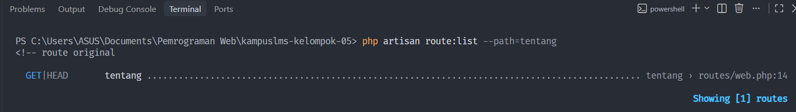

### READ — Telusuri satu request penuh (30 menit)

Ambil route `/tentang` yang Anda buat minggu lalu. Tanpa AI, tulis di catatan Anda:

1. Baris mana di `routes/web.php` yang menangkapnya?
2. Kalau ditangani controller, berkas dan method mana?
3. View mana yang dikembalikan? Di path apa persisnya?
4. Layout apa yang membungkusnya?
5. Jalankan `php artisan route:list --path=tentang`. Cocok dengan analisis Anda?

Jawaban

1. Ada di baris:
```php
Route::get('/tentang', function () { 
    return view('tentang'); 
})->name('tentang');
```
2. Saat ini rute `/tentang` langsung ditangani di route. Jika dialihkan ke controller, perlu dibuat berkas class controller baru di dalam folder `controller` beserta method pemanggilnya.

3. View yang dikembalikan yaitu `tentang.blade.php` yang berada di `resources/views/tentang.blade.php`

4. Awalnya masih berbentuk HTML polos, tidak ada layout, setelah dirapikan jadi dibungkus `<x-layout>` yang ada di `resources/views/components/layout.blade.php`

5. `php artisan route:list --path=tentang`

    

### BREAK — Delapan kerusakan (40 menit)

Lakukan berurutan. Untuk setiap nomor, **tulis prediksi Anda dulu** sebelum menjalankan.

| # | Yang dirusak | Prediksi | Yang Sebenarnya Terjadi |
|---|---|---|---|
| 1 | Ubah `Route::get` menjadi `Route::post` pada route daftar mata kuliah | Muncul pesan error karena routenya berbeda | Muncul error 405 Method Not Allowed karena route hanya menerima method POST, sedangkan halaman dibuka menggunakan method GET. |
| 2 | Ubah nama view di `return view(...)` menjadi yang tidak ada | Error karena mencari file view yang tidak ada | error `View [] not found` |
| 3 | Hapus `->name('courses.show')`, lalu muat halaman yang memakai `route('courses.show')` | Error karena route `courses.show` tidak punya nama. | error `Route [mata-kuliah.show] not defined` |
| 4 | Pindahkan `/courses/{course}` ke ATAS `/courses/create`, lalu buka `/courses/create` | Route `/courses/create` akan dianggap sebagai parameter `{course}`, sehingga halaman create tidak terbuka dengan benar. | Ketika `/courses/create` diakses, Laravel mengira kalo create itu nilai dari parameter {course}. Akibatnya, controller mencari data dengan ID "create" dan menghasilkan 404 Not Found dari abort(404). Setelah route `/courses/create` dipindahkan ke atas route `{course}`, halaman tersebut berhasil ditangkap oleh route yang benar dan menampilkan "Form buat mata kuliah baru". |
| 5 | Ganti `{{ $nama }}` menjadi `{!! $nama !!}`, isi `$nama` dengan `<script>alert('XSS')</script>` | Menggunakan `{{ $nama }}` hanya menampilkan tapi `{!! $nama !!}` menjalankannya sebagai perintah. | Muncul pop upnya karena `!` fungsinya buat menjalankan perintah |
| 6 | Hapus `@vite(...)` dari layout | Javascript sama css tidak terhubung ke browsernya | Tampilan halaman menjadi tidak normal karena CSS dan JavaScript dari Vite tidak termuat setelah `@vite(...)` dihapus. |
| 7 | Hentikan `npm run dev` lalu muat ulang halaman | Aset CSS dan JavaScript tidak akan termuat sehingga tampilan halaman menjadi tidak normal. | Halaman tetap bisa dibuka, tetapi perubahan pada CSS dan JavaScript tidak lagi diterapkan karena server Vite dihentikan. |
| 8 | Panggil `route('courses.show')` tanpa mengirim parameter | Akan muncul error karena parameter yang dibutuhkan oleh route courses.show tidak diberikan. | Muncul error Missing required parameter karena route courses.show membutuhkan parameter course.